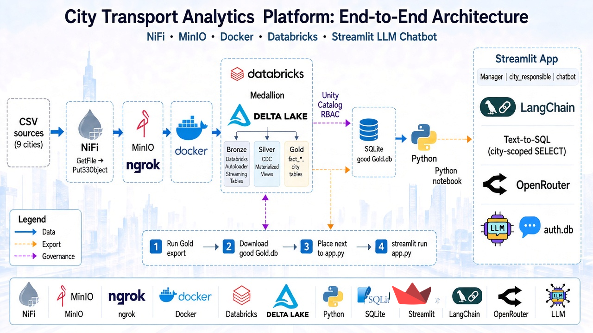
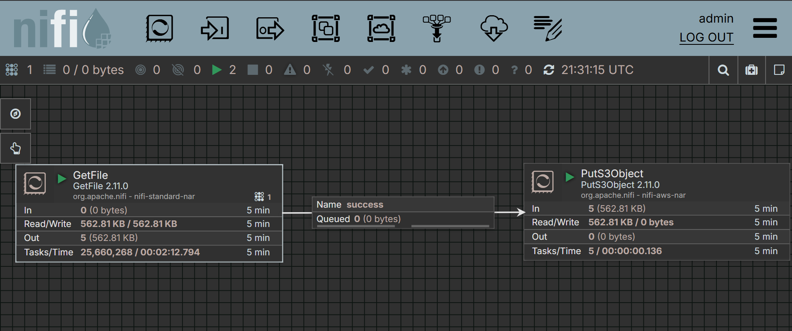
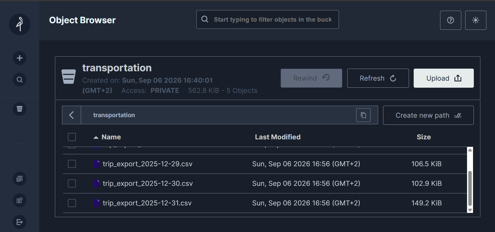
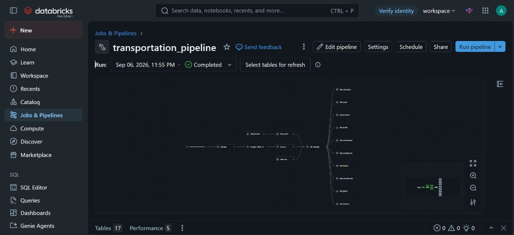
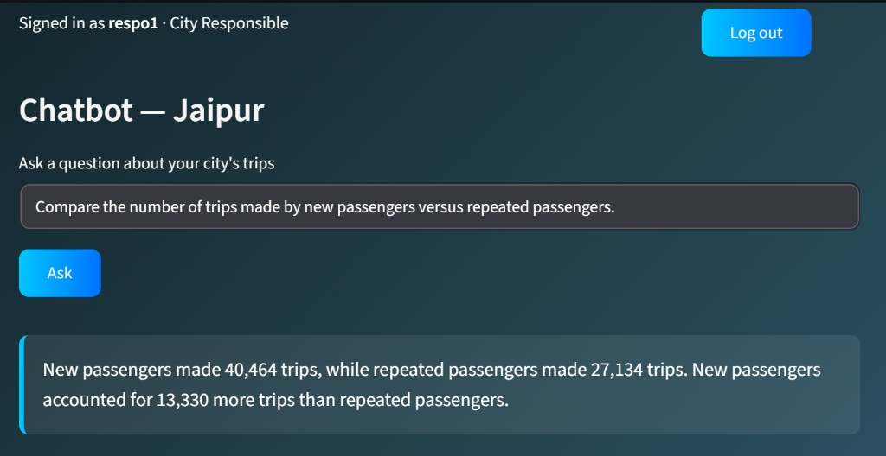
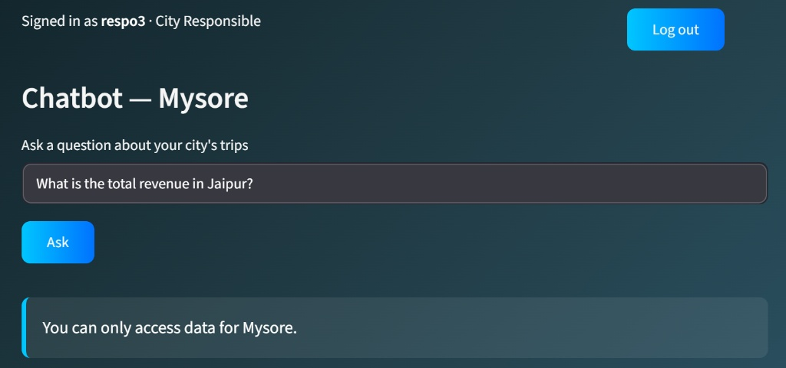

# City Transport Analytics Using Databricks

End-to-end pipeline on ride-hailing trip data from Indian cities: daily CSV exports are moved by NiFi into MinIO, processed in Databricks through a bronze / silver / gold medallion pipeline, exported to SQLite, and served through a Streamlit app where each city responsible queries their own city's data in natural language.



## Architecture

```
CSV → NiFi → MinIO (Docker) → ngrok → boto3 → Databricks Volume
    → Auto Loader → Bronze → Silver (Auto CDC) → Gold (per-city views)
    → SQLite export → Streamlit + LLM
```

MinIO runs locally and is exposed through ngrok. A notebook pulls new files with boto3 into a Unity Catalog Volume, which Auto Loader ingests incrementally (Databricks Free Edition / serverless).

## Repo layout

| Path | Content |
| --- | --- |
| `ingestion/` | NiFi + MinIO stack (`docker-compose.example.yml`) |
| `databricks/project_setup.py` | creates the `transportation` catalog and the bronze / silver / gold schemas |
| `databricks/minio_to_volume.py` | copies the files from the MinIO bucket into the Volume |
| `databricks/pipeline/transformations/` | Lakeflow Declarative Pipeline (bronze, silver, gold) |
| `databricks/grants.sql` | Unity Catalog grant on a city table |
| `databricks/export_gold_to_sqlite.py` | gold tables → `good_gold.db` |
| `app.py`, `agent.py`, `set_up_auth.py` | Streamlit app, text-to-SQL agent, auth bootstrap |
| `data/sample/` | `city.csv` + a few daily trip files |
| `docs/` | architecture diagram and screenshots |

## Data

- `city.csv` : 10 cities (`city_id`, `city_name`)
- `trip_export_YYYY-MM-DD.csv` : one file per day, columns `trip_id, date, city_id, passenger_type, distance_travelled(km), fare_amount, passenger_rating, driver_rating`
- full load : 1 Aug → 26 Dec 2025 (148 files), incremental load : 27 → 31 Dec 2025

Only a sample is included in `data/sample/`.

## Ingestion

`ingestion/docker-compose.example.yml` starts NiFi (`8443`) and MinIO (`9000` API, `9001` console). Copy it to `docker-compose.yml` and set your own passwords.

NiFi flow : `GetFile` → `PutS3Object`

- `GetFile` : watches the incremental load folder every 30 s, batch of 10, source files removed after pickup
- `PutS3Object` : bucket `transportation`, endpoint `http://minio-storage:9000`, credentials in an `AWSCredentialsProviderControllerService`

MinIO is exposed with ngrok so Databricks can reach it. `databricks/minio_to_volume.py` reads the endpoint and keys from a secret scope:

```bash
databricks secrets create-scope minio
databricks secrets put-secret minio endpoint_url
databricks secrets put-secret minio access_key
databricks secrets put-secret minio secret_key
```

## Databricks pipeline

Pipeline `transportation_pipeline` (serverless, triggered), catalog `transportation`, configuration `start_date = 2025-01-01`, `end_date = 2025-12-31` (used by the calendar).

| Layer | Object | Type |
| --- | --- | --- |
| Bronze | `voyage` | streaming table (Auto Loader on the Volume) |
| Bronze | `ville_bronze` | materialized view |
| Silver | `voyage_silver_staging` | view with expectations (date, ratings) |
| Silver | `voyage` | streaming table, Auto CDC on `id` (SCD type 1) |
| Silver | `silver_ville` | materialized view |
| Silver | `calendar` | materialized view (date attributes, Indian national holidays) |
| Gold | `fait_voyage` | trips joined with city and calendar |
| Gold | `fait_<city>` | one view per city |

Change Data Feed and auto optimize are enabled on the tables.

Run `project_setup.py` first, create the Volume `transportation.bronze.datasource`, then point the pipeline at `databricks/pipeline/transformations/**`.

## Export to SQLite

`databricks/export_gold_to_sqlite.py` reads each `transportation.gold.fait_<city>` table, writes it to `good_gold.db` (one table per city + `trips_summary`) and copies the file to `/Volumes/transportation/gold/exports/`. Download it from there and put it next to `app.py`.

## Streamlit app

### Roles

Stored in `auth.db` (created by `set_up_auth.py`):

- **manager** : creates `city_responsible` accounts and assigns a city
- **city_responsible** : chat only against their own city's table

Passwords are SHA-256 hashed.

### How the agent works

1. The question is rejected if it mentions another city.
2. `agent.py` injects only that city's table schema, plus the distinct values of its low-cardinality text columns.
3. The model returns a SELECT.
4. Anything that isn't a SELECT or doesn't target the allowed table is rejected.
5. The result is turned into a short answer (the SQL is not shown to the user).

The model goes through OpenRouter (`langchain-openai`).

### Setup

```bash
python -m venv .venv
# Windows
.venv\Scripts\activate
# mac/linux
# source .venv/bin/activate

pip install -r requirements.txt
```

Copy `.env.example` to `.env` and set your OpenRouter key:

```
OPENROUTER_API_KEY=...
```

Then:

```bash
python set_up_auth.py      # once, creates auth.db + the first manager
streamlit run app.py
```

`auth.db` and `good_gold.db` are expected in the same folder as `app.py`.

## Screenshots

| | |
| --- | --- |
| NiFi flow |  |
| MinIO bucket |  |
| Databricks pipeline |  |
| Chatbot answer |  |
| Access to another city |  |

## Credits

Medallion transformations adapted from the GoodCabs transportation project of a Databricks micro-course.
